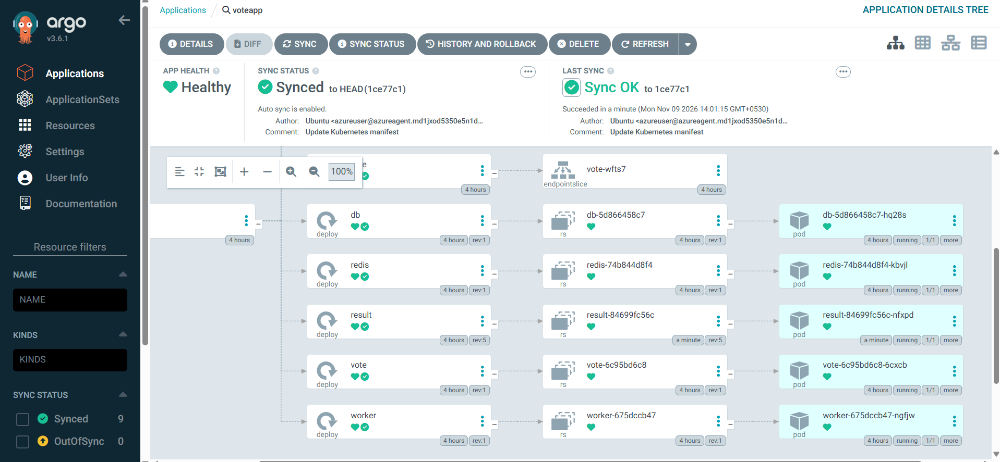
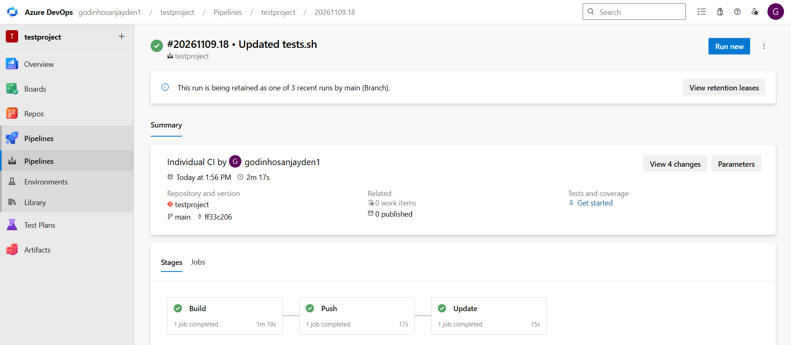
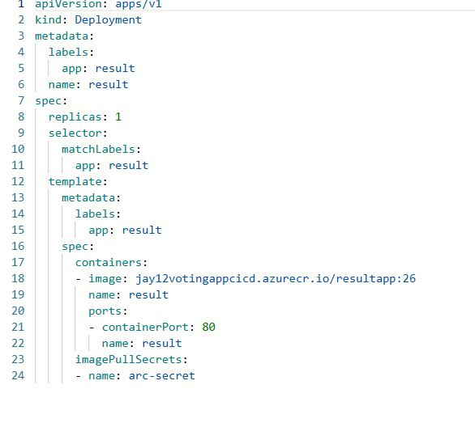

# End-to-End GitOps Deployment on Azure Kubernetes Service (AKS)

## Overview
This repository demonstrates GitOps-driven CI/CD architecture deploying a multi-tier polyglot microservices application onto **Azure Kubernetes Service (AKS)**. 

> **Attribution:** The underlying voting application source code is adapted from the official [Docker Example Voting App](https://github.com/dockersamples/example-voting-app). My work in this repository focuses on cloud infrastructure provisioning, Kubernetes orchestration, CI automation, and declarative Continuous Deployment using **Argo CD**.

---

## System & Deployment Architecture

### Application Stack
* **Vote Frontend (Python / Flask):** Web interface allowing users to cast votes between two options.
* **Message Queue (Redis):** In-memory data store queuing incoming votes.
* **Background Worker (.NET):** Consumes queued votes from Redis and persists them to the database.
* **Database (PostgreSQL):** Stores persistent vote records backed by Kubernetes PersistentVolumes.
* **Results Dashboard (Node.js):** Real-time web interface displaying live voting results via WebSockets.

### Cloud & DevOps Infrastructure (My Contributions)
* **Compute & Orchestration:** Deployed on **Azure Kubernetes Service (AKS)** backed by **Azure Virtual Machine Scale Sets (VMSS)** for scalable node pools.
* **Continuous Integration (CI):** Automated container image builds and registry pushes triggered on code/manifest changes (Azure Pipelines).
* **GitOps Continuous Deployment (CD):** Configured **Argo CD** inside the AKS cluster to continuously monitor this repository and automatically synchronize Kubernetes manifests (`Deployment`, `Service`, `PersistentVolumeClaim`) whenever declarative state changes occur.

---

## Deployment Workflow
1. Cluster Provisioning: Provisioned an AKS cluster on Azure configured with VMSS-backed node pools and configured kubectl context.

2. Argo CD Bootstrap: Installed Argo CD into the argocd namespace and exposed the Argo CD API server to manage cluster state.

3. CI Execution: Code updates trigger the CI pipeline to build updated Docker images, tag them, and push them to the container registry.

4. GitOps Sync (CD): Argo CD detects updated manifests/image tags in the target directory and reconciles the live AKS cluster state with zero manual kubectl apply interventions.

## Architecture

* A front-end web app in [Python](/vote) which lets you vote between two options
* A [Redis](https://hub.docker.com/_/redis/) which collects new votes
* A [.NET](/worker/) worker which consumes votes and stores them in…
* A [Postgres](https://hub.docker.com/_/postgres/) database backed by a Docker volume
* A [Node.js](/result) web app which shows the results of the voting in real time

## Notes

The voting application only accepts one vote per client browser. It does not register additional votes if a vote has already been submitted from a client.

This isn't an example of a properly architected perfectly designed distributed app... it's just a simple
example of the various types of pieces and languages you might see (queues, persistent data, etc), and how to
deal with them in Docker at a basic level.
